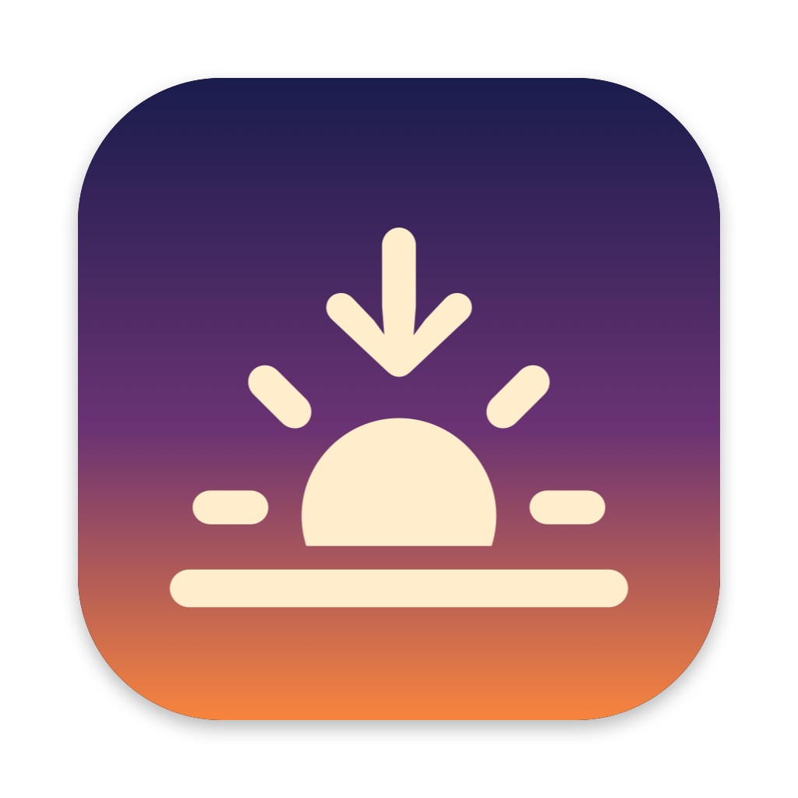
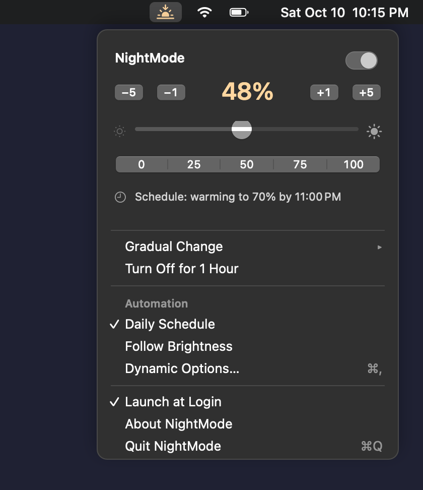
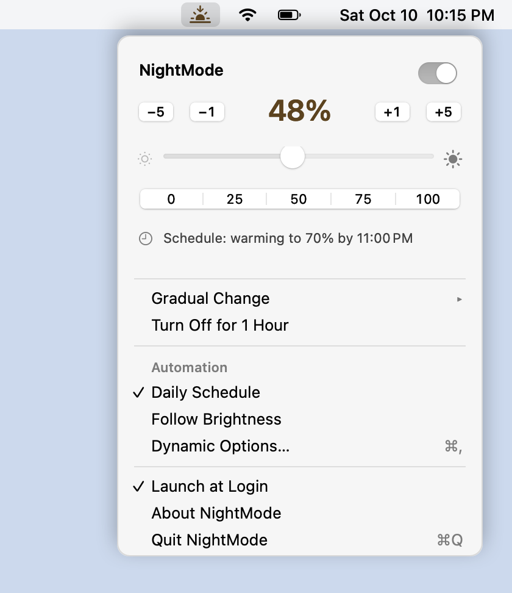
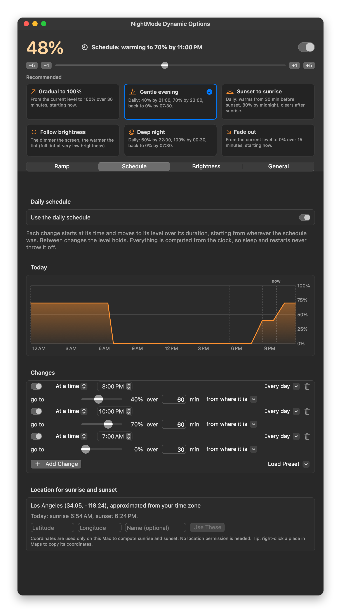
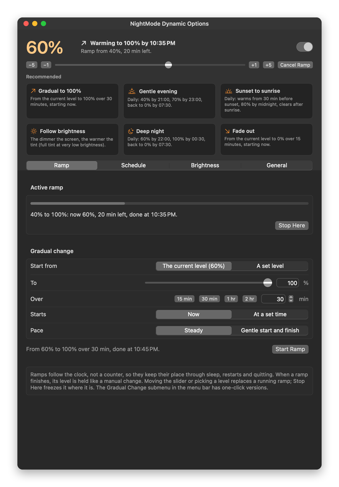
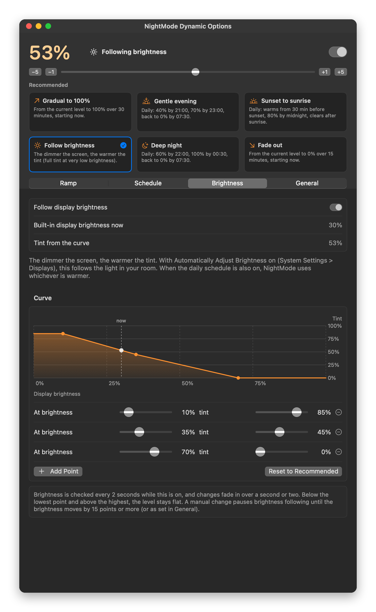
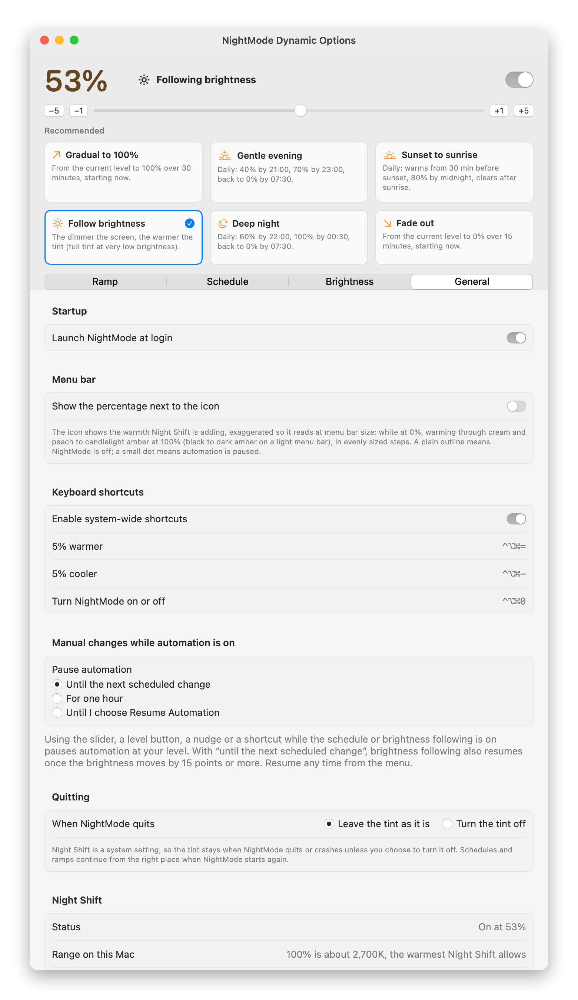
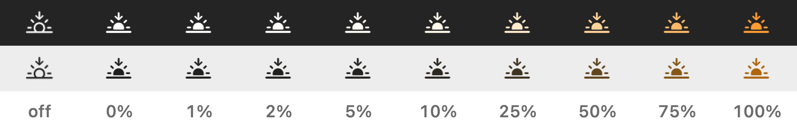

<p align="center"></p>

# NightMode

A small macOS menu bar app for precise control of Night Shift: exact levels, quick nudges, gradual ramps, daily schedules that warm up slowly instead of switching on all at once, and a tint that can follow your screen brightness.

**[Download NightMode.dmg](https://github.com/AaronBergman/NightMode/releases/latest/download/NightMode.dmg)** (signed and notarized). Requires macOS 13 Ventura or later on a Mac that supports Night Shift. Built for Apple Silicon and developed and tested on macOS 27; the download is a universal binary, so it also runs on Intel Macs, but that is only lightly tested.

<p align="center"> </p>

## What it does

- **Precise level control from the menu bar.** A slider, one-click levels (0, 25, 50, 75, 100%), and -5 / -1 / +1 / +5 buttons that keep the menu open so you can tap them repeatedly. The exact percentage is always shown.
- **An icon that shows the warmth being added.** The menu bar icon and the big percentage readout are colored with the white point Night Shift is producing, exaggerated so it reads at menu bar size: white at 0%, warming through cream and peach to candlelight amber at 100%, with every 1% step the same visible size. On a light menu bar the same hues run from black to dark amber. A plain outline means NightMode is off; a small dot means automation is paused by a manual change.
- **Gradual ramps.** "From the current level to 100% over 30 minutes", "from 20% to 80% over 2 hours starting at 21:00", or a quick fade out. Ramps follow the clock, so they keep their place through sleep, restarts and quitting.
- **Daily schedules with gradual changes.** For example: start warming at 20:00, reach 40% by 21:00, 70% by 23:00, and clear back to 0% by 07:30. Changes can be tied to a clock time or to sunset and sunrise (with an offset), and limited to certain weekdays. A chart shows the whole day.
- **Tint as a function of brightness.** The dimmer the screen, the warmer the tint, using a curve you can edit. With automatic brightness on, this effectively follows the light in your room.
- **Recommended presets** that fill everything in with one click: Gradual to 100%, Gentle evening, Sunset to sunrise, Follow brightness, Deep night, Fade out.
- **Keyboard shortcuts** that work anywhere, launch at login, an on/off switch that remembers your level, and "Turn Off for 1 Hour" for color-sensitive work.

Everything advanced lives in the **Dynamic Options** window (menu > Dynamic Options..., or press ⌘, while the menu is open).

<p align="center"></p>

<details>
<summary>More screenshots: ramps, brightness, settings</summary>
<p align="center"></p>
<p align="center"></p>
<p align="center"></p>
</details>

## Install

1. Download [NightMode.dmg](https://github.com/AaronBergman/NightMode/releases/latest/download/NightMode.dmg) from the [latest release](https://github.com/AaronBergman/NightMode/releases/latest).
2. Open it and drag **NightMode** onto **Applications**.
3. Open NightMode from Applications. A sunset icon appears in the menu bar, and the Dynamic Options window opens the first time so you can pick a preset.
4. To start NightMode automatically, turn on **Launch at Login** in the menu (macOS may show a notification that a login item was added).

The app is signed with a Developer ID and notarized by Apple, so it opens without Gatekeeper warnings.

## How the dynamic options work

### Ramps

A ramp moves the level from a start value to a target over a set time, either now or at a chosen clock time. The start can be "the current level" (taken at the moment the ramp begins) or a fixed level. Pace is either steady or "gentle start and finish". The Gradual Change submenu in the menu bar has one-click ramps (to 100% over 15, 30, 60 or 120 minutes; to 0% over 5, 15 or 30 minutes).

Ramps are computed from the wall clock: if your Mac sleeps halfway through a 30 minute ramp and wakes 10 minutes later, the level is exactly where it would have been. When a ramp finishes, its final level is held like a manual change (see below).

### Daily schedule

The schedule is a list of changes. Each change has a start (a clock time, or a number of minutes before or after sunset or sunrise), a target level, a duration, the days it runs, and where it starts from (by default, wherever the schedule was; optionally a fixed level). Between changes the level holds. If a change starts while another is still moving, it takes over smoothly from the current value.

The schedule's level is a pure function of the clock (NightMode replays the last 8 days of changes), so sleep, restarts and missed timers can never put it in the wrong place.

**Sunset and sunrise** are computed on your Mac with the NOAA solar equations. NightMode needs a location for this but never asks for location permission: by default it uses the reference city of your time zone (from the system's time zone database), and you can type exact coordinates in the Schedule tab. On days with no sunset (polar summer) sun-relative changes are skipped.

### Follow brightness

NightMode reads the built-in display's brightness (the position of the brightness slider) every 2 seconds while this is on, and maps it to a tint level through a curve of 2 to 6 points. Between points the curve is linear; beyond the ends it is flat. The default is: 85% at 10% brightness or below, 45% at 35%, and 0% at 70% brightness or above. Changes fade in over a second or two.

Brightness is read through the private `DisplayServices` framework, which is how it works on Apple Silicon. If it cannot be read (for example with the lid closed and only an external display), brightness following simply has no effect until it can.

## Which setting wins (precedence)

From highest to lowest:

1. **Off.** The on/off switch, or "Turn Off for 1 Hour", sets the tint to 0%. The slider keeps showing your level, and any control (slider, level button, nudge) switches NightMode back on.
2. **A running ramp.**
3. **A manual change while automation is on.** Using the slider, a level button, a nudge or a shortcut while the schedule or brightness following is on pauses automation at your level. By default the pause lasts **until the next scheduled change starts**, or, when following brightness, **until the brightness moves by 15 points or more**, whichever comes first. You can instead pause for one hour, or until you choose **Resume Automation** (always available in the menu while paused). A finished ramp's level is held the same way.
4. **Automation.** The daily schedule and the brightness curve. When both are on, NightMode uses whichever is warmer.
5. **The manual level**, when no automation is on.

A few more rules:

- A manual change replaces a running ramp (the level goes where you put it). **Cancel Ramp** instead stops it where it is. A manual change does not affect a ramp scheduled for later (use Cancel Scheduled Ramp for that).
- Turning automation on clears any pause and switches NightMode on. Turning all automation off keeps the level automation had reached, so nothing jumps.
- Changes made outside NightMode (Control Center, System Settings) are treated as manual changes. One exception: macOS treats a manually enabled Night Shift as "on until tomorrow" and can switch it off at the end of its own Night Shift window (07:00 by default). If that happens while NightMode's automation is in charge, NightMode puts the level back; in plain manual mode it respects the switch-off, like macOS does.

## Keyboard shortcuts

| Shortcut | Action |
| --- | --- |
| ⌃⌥⌘ = | 5% warmer |
| ⌃⌥⌘ - | 5% cooler |
| ⌃⌥⌘ 0 | Turn NightMode on or off |

They work in any app and need no special permissions. You can turn them off in Dynamic Options > General.

## The menu bar icon

<p align="center"></p>

The color is meant to feel like the warmth itself, just stronger. Each level's color is a point on the Planckian locus (the colors of a glowing blackbody, which is the path Night Shift moves your screen along), running from neutral 6500 K at 0% toward about 2230 K at 100%. That is Night Shift's real range (6000 K to 2700 K) exaggerated 1.45 times in mireds, so a shift that is gentle across a whole screen still shows on a small glyph.

The levels are spaced by how different they look (equal distances in the OKLab color space), so 0% to 1% is exactly as visible as 1% to 2% or 99% to 100%. That means the low end changes slowly: 5% is only a hint of cream. On a light menu bar the same hues run from template black to a dark amber that keeps at least 3.8:1 contrast with the bar. The filled icon is drawn the same way at every level, including 0%; only "off" uses the outline.

Optionally, NightMode can also show the percentage next to the icon, in the same color (Dynamic Options > General).

## FAQ

**Does it work with Night Shift? With True Tone?** NightMode *is* Night Shift: it drives the same system feature that System Settings and Control Center use, just with finer control. True Tone is a separate system feature and keeps working alongside it.

**Can it go warmer than 100%?** No. 100% is the warmest Night Shift allows (about 2700K on recent MacBook Pros; the General tab shows the range on your Mac). Going further would need gamma-table tricks, which conflict with other color tools, reset on display changes, and do not survive a crash cleanly. NightMode deliberately stays with Night Shift.

**What happens when NightMode quits or crashes?** Night Shift is a system setting, so the screen stays exactly as it was. Nothing needs restoring. If you prefer, Dynamic Options > General can turn the tint off when NightMode quits (and restore it at the next launch). Ramps and schedules pick up at the right place when NightMode starts again.

**Why does the tint sometimes switch off on its own, or the screen jump?** Usually another controller is fighting NightMode: macOS's own Night Shift schedule (System Settings > Displays > Night Shift > Schedule), or an app like f.lux. NightMode warns you in the Schedule tab when the macOS schedule is on and can turn it off with one click. Large automatic changes (a schedule starting, resuming automation, a big brightness change) fade over a second or two on purpose.

**Does it work on external displays?** The tint applies to every display Night Shift supports, because macOS handles that. Brightness following reads the built-in display only.

**Does it drain the battery?** No. In manual mode NightMode sets no timers at all and only wakes for events (sleep, wake, clock changes, Night Shift changing elsewhere). With a schedule on, it wakes at the next scheduled change (and at least every 15 minutes to stay in sync). During a ramp it updates at most once a second, usually every few seconds. Brightness following reads one value every 2 seconds.

**Does it need any permissions or send any data?** No permissions (no location, no accessibility, no screen recording) and no network access. Settings are stored in the app's preferences on your Mac.

**Why is it not on the Mac App Store?** Night Shift and display brightness are only reachable through private system frameworks (`CoreBrightness` and `DisplayServices`), which the App Store does not allow. NightMode calls them defensively: if a future macOS changes them, NightMode reports that Night Shift is unavailable instead of crashing.

**How do I check what NightMode can see on my Mac?** Run `/Applications/NightMode.app/Contents/MacOS/NightMode --self-test` in Terminal. It prints the Night Shift status, the color temperature range, the brightness reading, the approximate location and today's sun times, and changes nothing.

## Uninstall

1. In the NightMode menu, turn off **Launch at Login** (or remove it in System Settings > General > Login Items), then choose **Quit NightMode**.
2. Drag NightMode from Applications to the Trash.
3. Optionally remove its settings: `defaults delete com.aaronbergman.nightmode`
4. Night Shift stays at its last level. Turn it off in Control Center or System Settings > Displays > Night Shift if you like.

## Build from source

The package targets Swift 5.9 and macOS 13 and has no third-party dependencies. It is built and tested with Xcode 27 (Swift 6.4); older Xcode versions may work but are untested.

```sh
swift test                      # unit tests: ramps, schedules, solar maths, brightness curves, precedence, icon colors, app behavior
scripts/build.sh                # builds build/NightMode.app (universal); signs with your Developer ID if you have one, else ad hoc
open build/NightMode.app
swift run RenderScreenshots     # regenerates the images in docs/images, offscreen, with a mock Night Shift
swift scripts/make-icon.swift   # regenerates Resources/AppIcon.icns
scripts/release.sh              # signed + notarized dist/NightMode.dmg (see the script for credentials)
```

The code is split into `NightModeCore` (pure logic with no AppKit: ramps, schedules, NOAA sunrise and sunset, brightness curves, and the precedence engine, all tested with injected clocks), `NightModeApp` (menu bar item, Dynamic Options window, the Night Shift and brightness bridges), and a thin `NightMode` executable. The tests compare the solar code against the independent `astral` implementation for 8 cities across the year (worst difference 71 seconds), and drive the app model against a mock Night Shift so no test ever touches your screen.

## Upgrading from NightMode 1.x

Version 2 migrates automatically: it keeps your current Night Shift level, moves the menu bar icon to the same position, replaces the old LaunchAgent with a normal login item (the old plist goes to the Trash), and quits a running 1.x copy so the two never fight.

## Changelog

See [CHANGELOG.md](CHANGELOG.md).

## License

MIT. See [LICENSE](LICENSE).
